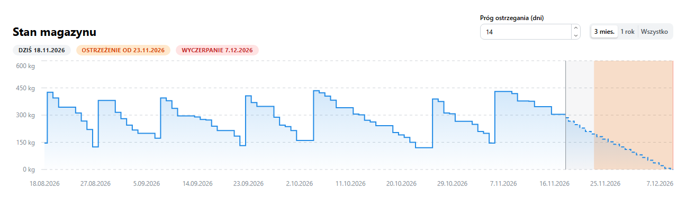
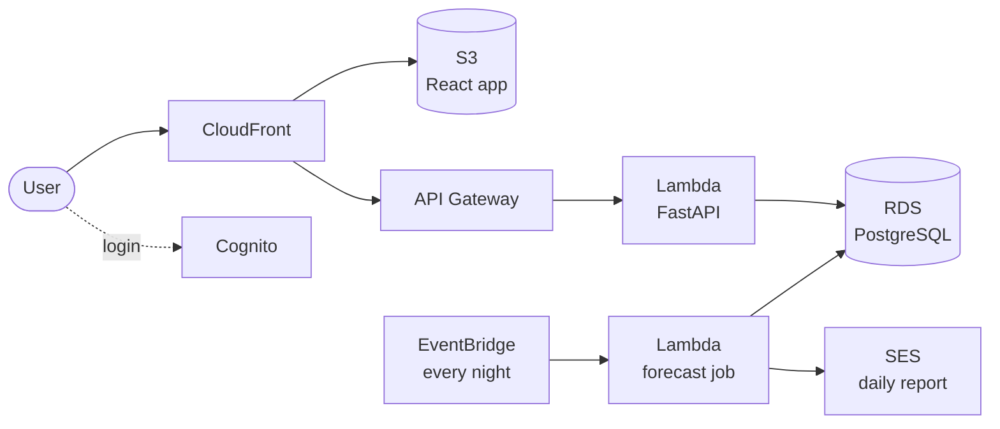

# Hi, I'm Michał

I'm a **Python backend developer**. I build APIs with FastAPI and PostgreSQL, run them on AWS, and use AI agents as part of how I deliver software: I write the spec, make the design decisions and review the result.

I study Computer Science (cloud specialization) and completed EPAM's trainee programs. **I'm open to junior backend roles**, remote or around Wrocław.

📫 **perczak.michal.pl@gmail.com**

---

## [Inventory Management with Demand Forecasting](https://github.com/mperpl/inventory-forecasting)

**It shows a small producer when each item will run out, while there's still time to reorder.**

Demo data, Polish interface. Solid line: actual stock. Dashed line: forecast. Orange: the warning period before stock runs out.

- **Forecasting:** picks a method for each item by checking it against recent weeks it hasn't seen, and recalculates every night
- **Daily report:** what is about to run out arrives by email
- **History you can trust:** stock movements are never edited, only reversed, and changes are logged automatically
- **Cloud on demand:** scripts bring the AWS app up for a demo and take it down afterwards

**How it was made:** the spec, the design decisions and the backend review are mine. AI agents wrote much of the backend and all of the frontend and Terraform.

---

## Also built

**MCP server for a restaurant booking platform** · EPAM team project, private code 
Turns the backend's OpenAPI description into tools that AI agents can call, checking input before it reaches the backend.

**Agent workflow for a postal service app** · EPAM AI program, private code 
Claude Code subagents that plan, implement, review and test, run by an orchestrator I designed.

---

## What I work with

**Backend:** Python · FastAPI · SQLAlchemy · Pydantic · Alembic · Pytest 
**Data:** PostgreSQL · Valkey / Redis 
**AWS:** Lambda · API Gateway · S3 · SQS · RDS · Cognito · SES · EventBridge 
**AI:** Claude Code · MCP · LLM API integration 
**Tools:** Docker · Git · Linux
